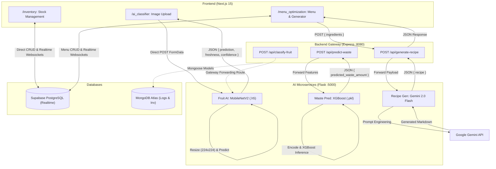

# SmartRasoi: AI-Powered Smart Kitchen & Waste Minimizer

SmartRasoi is a full-stack, AI-driven kitchen management and food waste reduction platform designed to help commercial kitchens, restaurants, and food service operators monitor inventory in real time, classify produce freshness using computer vision, optimize menus, and dynamically generate surplus-driven recipes using generative AI.

---

## Project Overview

Food service businesses face persistent operational challenges: ingredients spoil before use, high-cost surplus items go unmonitored, freshness inspections are manual, and menu planning frequently fails to utilize near-expiry stock. SmartRasoi addresses these inefficiencies by integrating real-time database tracking with specialized machine learning and generative artificial intelligence microservices.

The system combines:
1. **Interactive Real-Time Inventory Tracking:** Built on Next.js 15 and Supabase (PostgreSQL), providing real-time data synchronization for stock levels, shelf-life countdowns, and automated expiration status flagging (`optimal`, `low`, `expiring`).
2. **Computer Vision Food Freshness Classification:** A TensorFlow/Keras MobileNetV2 deep learning classifier that inspects uploaded fruit images (strawberries, pomegranates, and peaches) to detect freshness versus decay.
3. **Surplus-Driven Recipe Generation:** A Google Gemini 2.0 Flash generative service that transforms selected available ingredients into structured recipes with step-by-step cooking instructions, equipment lists, and culinary highlights.
4. **Predictive Food Waste Estimation:** An XGBoost machine learning model trained to estimate expected food waste quantities (in kilograms) based on food types, event scales, guest counts, preparation styles, and environmental storage conditions.
5. **Menu & Profitability Management:** A menu control module tracking ingredient costs, selling prices, and automated profit margins alongside real-time database state changes.

---

## Problem Statement

Commercial kitchens lose thousands of dollars each month and produce immense ecological waste due to three fundamental operational gaps:
- **Lack of Expiration Visibility:** Stock managers and chefs often do not know which items are approaching expiration until they are already spoiled.
- **Disconnected Recipe Planning:** Menu items are traditionally designed without considering surplus or near-expiry inventory, causing perishable ingredients to be discarded rather than repurposed.
- **Subjective Quality Inspection:** Food freshness checks rely on manual, inconsistent visual estimates, increasing the risk of serving deteriorated ingredients or prematurely discarding salvageable items.

---

## Proposed Solution

SmartRasoi bridges the gap between raw kitchen inventory and daily culinary production through an interconnected four-layer ecosystem:
- **Client Presentation Tier (Next.js):** Provides kitchen staff and managers with reactive dashboards for inventory auditing, menu cataloging, and image-based freshness checks.
- **Orchestration API Gateway (Node.js & Express):** Centralizes requests, handles file uploads via memory buffers, and routes tasks to the appropriate microservices.
- **AI Microservices Layer (Python & Flask):** Hosts distinct AI models for computer vision classification, LLM-based recipe generation, and gradient-boosted waste prediction.
- **Data Persistence Tier (Supabase PostgreSQL & MongoDB Atlas):** Stores transactional inventory records, menu catalogs, and waste logs with WebSocket-driven real-time change events.

---

## Key Features

### 1. Real-Time Inventory Control (`/inventory`)
- **Inventory Auditing:** View and manage item names, categories, quantities, measurement units, monetary amounts, and expiration dates.
- **Dynamic Status Tagging:** Items are categorized into `optimal`, `low`, or `expiring` states.
- **Expiration Countdown:** Automatically calculates remaining days until expiry from the system clock to the recorded `expiry_date`.
- **Filtered Tab Views:** Dedicated dashboard tabs for "All Items", "Low Stock", and "Expiring Soon".
- **Category Filtering & Search:** Instant text search across item names and categories, plus dropdown filtering by category (Vegetables, Fruits, Dairy, Grains, Bakery).
- **CRUD Operations with Real-Time Sync:** Add, edit, and delete items via modal dialogs, with automatic view re-rendering via Supabase `postgres_changes` subscriptions.

### 2. AI Produce Freshness Classifier (`/ai_classifier`)
- **Image Upload & Live Preview:** Upload produce images directly through the web interface with instant visual previews and clearing controls.
- **Convolutional Neural Network Inference:** Analyzes uploaded photos using a pre-trained 158-layer MobileNetV2 transfer learning model.
- **Multi-Class Detection:** Identifies 6 fruit quality categories:
  - Fresh Strawberry vs. Rotten Strawberry
  - Fresh Pomegranate vs. Rotten Pomegranate
  - Fresh Peach vs. Rotten Peach
- **Diagnostic Metrics:** Returns binary freshness verdict (`Fresh` or `Rotten`), specific predicted class label, and percentage confidence score.

### 3. Intelligent Menu Optimization & Recipe Generator (`/menu_optimization`)
- **Menu Catalog Management:** Add, update, delete, and view dishes with real-time database synchronization.
- **Automated Profit Margin Calculation:** Evaluates item profitability using the formula:
  $$\text{Profit Margin (\%)} = \frac{\text{Price} - \text{Cost}}{\text{Price}} \times 100$$
- **Live Inventory-Linked Recipe Generation:** Fetches active ingredient names directly from the database, allowing kitchen staff to multi-select surplus ingredients.
- **Generative AI Structuring:** Invokes Google Gemini 2.0 Flash to synthesize structured recipe titles, ingredient quantities, cooking equipment requirements, step-by-step preparation instructions, and unique recipe features.

### 4. Predictive Food Waste Engine (Backend & AI Service)
- **Gradient-Boosted Waste Estimation:** Powered by an `XGBoostRegressor` trained on hospitality and catering data.
- **Multivariate Feature Processing:** Accepts 10 operational parameters (8 categorical, 2 numerical) including food type, event type, guest count, preparation method, and storage conditions.
- **Automatic Label Encoding:** Pre-processes categorical attributes using pre-fitted Scikit-Learn `LabelEncoder` pipelines.

---

## How It Works (Step-by-Step)



### Detailed Operational Workflow

1. **Inventory Recording & Expiry Tracking:**
   - Kitchen staff records incoming stock through the `/inventory` modal dialog (specifying name, category, quantity, unit, cost, status, and expiry date).
   - Records are inserted into the Supabase `inventory` table.
   - The UI subscribes to PostgreSQL changes via WebSocket (`supabase.channel("inventory-changes")`), updating the interface in real time across all open client sessions.
   - The interface computes the number of days until expiration:
     $$\text{Days Remaining} = \left\lceil \frac{\text{Expiry Date} - \text{Current Date}}{86,400,000 \text{ ms}} \right\rceil$$
   - Items with low remaining shelf life are highlighted under the "Expiring Soon" tab.

2. **Produce Quality Inspection:**
   - Kitchen staff captures or uploads a photo of fruit via `/ai_classifier`.
   - The image is packaged into a `FormData` object and transmitted via HTTP POST to the AI classifier service (`/predict`).
   - The Flask service reads the image stream via Pillow, converts color channels to RGB, resizes dimensions to $224 \times 224$ pixels, normalizes pixel intensities to $[0, 1]$, and expands dimensions to $(1, 224, 224, 3)$.
   - The MobileNetV2 model executes forward propagation, calculating Softmax probabilities across 6 target classes.
   - The service extracts the highest-probability index, parses freshness status, and returns the classification label and confidence percentage to the frontend.

3. **Menu Optimization & Recipe Synthesis:**
   - The chef navigates to `/menu_optimization` and opens the "Recipe Generator" tab.
   - The component queries Supabase for all active ingredient names in the kitchen inventory.
   - The chef selects surplus or expiring ingredients and clicks "Generate Recipe".
   - The request is dispatched to Express backend (`/api/generate-recipe`), which delegates to the Recipe Recommendation Flask service (`/generate_recipe`).
   - The service constructs an explicit prompt instructing Gemini 2.0 Flash to synthesize a formatted culinary plan.
   - The returned Markdown text is parsed client-side via regular expressions to extract Title, Ingredients, and Instructions into clean preview sections.

4. **Food Waste Prediction:**
   - Operational parameters (food type, guest count, preparation method, event type, etc.) are posted to Express `/api/predict-waste`.
   - The backend forwards the payload to the Waste Prediction Flask service.
   - The service converts categorical features to integers via pre-trained Scikit-Learn `LabelEncoder` objects and predicts estimated food waste mass via `XGBRegressor`.

---

## System Architecture

SmartRasoi implements a decoupled microservices and tiered client-server architecture:

```
SmartRasoi/
├── Frontend (Port 3000)      --> Next.js 15 (React 19, TypeScript, Tailwind CSS, ShadCN)
├── Backend Gateway (Port 8080) --> Express.js (Middleware, Multer, Axios routing)
├── AI Services (Port 5000)   --> Python Flask Microservices
│   ├── Fruit AI              --> MobileNetV2 CNN (Keras / TensorFlow)
│   ├── Recipe Recommendation --> Google Gemini 2.0 Flash
│   ├── Dish Recommendation   --> Google Gemini 2.0 Flash Title Generator
│   └── Waste Prediction      --> XGBoost Regressor + Scikit-Learn Encoders
└── Databases
    ├── Supabase (Cloud)      --> PostgreSQL with Realtime Replication
    └── MongoDB Atlas (Cloud) --> Document Storage for Waste Logs & Inventory
```

---

## Technology Stack

### Frontend Application
| Technology | Version | Purpose |
| :--- | :--- | :--- |
| **Next.js** | `15.2.4` | Full-stack React framework with App Router & Turbopack |
| **React** | `^19.0.0` | UI component library |
| **TypeScript** | `^5` | Static type safety |
| **Tailwind CSS** | `^4.0.17` | Utility-first styling engine |
| **Radix UI Primitives** | Various | Accessible headless UI building blocks (Dialog, Tabs, Select, etc.) |
| **Lucide React** | `^0.485.0` | Iconography suite |
| **Supabase JS SDK** | `^2.49.4` | Client-side PostgreSQL interface and Realtime subscriptions |
| **Axios** | `^1.8.4` | HTTP client for microservice communication |
| **Next-Themes** | `^0.4.6` | Dark and light theme switching |
| **Recharts** | `^2.15.1` | Charting and visualization library |
| **React Hook Form / Zod** | `^7.55.0` / `^3.24.2` | Form management and schema validation |

### Backend Gateway
| Technology | Version | Purpose |
| :--- | :--- | :--- |
| **Node.js** | `>= 20.x` (Verified on `v22.21.0`) | JavaScript runtime environment |
| **Express.js** | `^4.21.2` | RESTful API server framework |
| **Axios** | `^1.8.4` | Upstream HTTP proxy client to Flask microservices |
| **Multer** | `^1.4.5-lts.2` | In-memory multipart/form-data upload handling |
| **MongoDB Driver** | `^6.15.0` | Official native MongoDB driver |
| **Mongoose** | `^8.13.1` | MongoDB Object Data Modeling (ODM) |
| **Prisma ORM** | `^6.5.0` | PostgreSQL schema modeling (`schema.prisma`) |
| **Dotenv** | `^16.4.7` | Environment variable management |
| **Cors** | `^2.8.5` | Cross-Origin Resource Sharing middleware |

### AI & Machine Learning Services
| Technology | Version / Specification | Purpose |
| :--- | :--- | :--- |
| **Python** | `3.10+` (Verified on `3.11.9`) | AI runtime language |
| **Flask** | Microservice framework | REST API service hosting |
| **Flask-CORS** | Extension | Cross-origin resource sharing for AI endpoints |
| **TensorFlow / Keras** | `3.9.1` (Keras artifact format) | Deep learning framework hosting MobileNetV2 (`fruit_classifier.h5`) |
| **Pillow (PIL)** | Image library | Image decoding, resizing ($224 \times 224$), and RGB formatting |
| **XGBoost** | `XGBRegressor` | Gradient-boosted decision trees for waste prediction |
| **Scikit-Learn** | `1.5.2` (Training pipeline) | Categorical variable transformation via `LabelEncoder` |
| **Pandas / NumPy** | Data manipulation | Tabular dataframes and numeric array processing |
| **Google Generative AI SDK** | `google-generativeai` | Cloud integration with Gemini 2.0 Flash |

---

## Project Structure

```
SmartRasoi/
├── README.md                                  # Root project documentation
├── ai/                                        # Python AI and Machine Learning microservices
│   ├── Dish Recommandation/
│   │   ├── app.py                             # Flask app: Gemini title generator (/generate_title)
│   │   └── script.js                          # Client fetch script for title generator
│   ├── Fruit AI/
│   │   ├── app.py                             # Flask app: MobileNetV2 fruit classifier (/predict)
│   │   └── fruit_classifier.h5                # Keras Functional model artifact (11.5 MB)
│   ├── Recipe Recommandation/
│   │   ├── app.py                             # Flask app: Gemini recipe generator (/generate_recipe)
│   │   ├── index.html                         # Standalone testing interface for recipe generation
│   │   └── script.js                          # Standalone client script with regex markdown parser
│   └── Waste Prediction/
│       ├── app.py                             # Flask app: XGBoost waste predictor (/predict)
│       ├── label_encoders.pkl                 # Pickled Scikit-Learn categorical encoders (1 KB)
│       └── waste_model.pkl                    # Pickled XGBoost regression booster (768 KB)
├── backend/                                   # Node.js Express API gateway
│   ├── .env                                   # Backend environment variables
│   ├── package.json                           # Backend dependencies and scripts
│   ├── server.js                              # Main Express server and proxy route definitions
│   ├── config/
│   │   └── mongoDB.js                         # Native MongoDB Atlas connection configuration
│   ├── controllers/
│   │   ├── inventoryController.js             # Mongoose inventory CRUD handlers
│   │   └── wasteController.js                 # Mongoose waste logging handler
│   ├── models/
│   │   ├── Inventory.js                       # Mongoose Inventory schema
│   │   └── WasteLog.js                        # Mongoose WasteLog schema
│   ├── prisma/
│   │   └── schema.prisma                      # Prisma schema for PostgreSQL Inventory model
│   └── routes/
│       ├── inventoryRoutes.js                 # Express routes for inventory endpoints
│       └── wasteRoutes.js                     # Express routes for waste log endpoints
└── frontend/                                  # Next.js 15 client application
    ├── .env.local                             # Frontend environment variables (Supabase)
    ├── components.json                        # ShadCN UI configuration
    ├── next.config.ts                         # Next.js build configuration
    ├── package.json                           # Frontend dependencies and npm scripts
    ├── tsconfig.json                          # TypeScript compiler configuration
    └── src/
        ├── app/
        │   ├── globals.css                    # Tailwind CSS v4 directives and design tokens
        │   ├── layout.tsx                     # Root layout with ThemeProvider and Navbar
        │   ├── page.tsx                       # Landing page
        │   ├── ai_classifier/
        │   │   └── page.tsx                   # Fruit freshness classification dashboard
        │   ├── inventory/
        │   │   └── page.tsx                   # Real-time inventory table and CRUD dialogs
        │   └── menu_optimization/
        │       └── page.tsx                   # Menu items and recipe generator tabs
        ├── components/
        │   ├── AISuggestion.tsx               # Static mock recipe suggestions (unmounted)
        │   ├── CurrentMenu.tsx                # Menu item catalog and profit margin management
        │   ├── ModeToggle.tsx                 # Light / Dark theme toggle button
        │   ├── Navbar.tsx                     # Global navigation bar
        │   ├── RecipeGenerator.tsx            # Inventory-linked recipe synthesis tab
        │   ├── ThemeProvider.tsx              # Next-themes wrapper
        │   └── ui/                            # 20+ ShadCN UI components (Button, Dialog, etc.)
        ├── lib/
        │   ├── supabase.ts                    # Initialized Supabase browser client
        │   └── utils.ts                       # Tailwind className merging helper (cn)
        └── utils/
            └── fetchSpoilableValue.ts         # Utility calculation function (commented out)
```

---

## Technical Implementation

### 1. Computer Vision Architecture (`fruit_classifier.h5`)
- **Base Network:** MobileNetV2 backbone initialized with frozen ImageNet convolutional weights (`trainable: false` on feature extraction stages).
- **Depth & Layers:** 158 total layers consisting of depthwise separable convolutions, batch normalization, and ReLU6 activations.
- **Classification Head:**
  - `GlobalAveragePooling2D`
  - `Dense` layer with ReLU activation
  - `Dropout` layer ($p \approx 0.2$) for regularization
  - Final `Dense` layer with 6 output nodes and Softmax activation
- **Input Dimensions:** Expects tensor input of shape `(batch_size, 224, 224, 3)`.
- **Training Loss & Metrics:** Trained with `categorical_crossentropy` and Adam optimizer.

### 2. Waste Prediction Architecture (`waste_model.pkl`)
- **Algorithm:** Extreme Gradient Boosting (`xgboost.sklearn.XGBRegressor`).
- **Objective Function:** `reg:squarederror`.
- **Feature Set:**
  | # | Feature Name | Data Type | Encoding / Range |
  | :- | :--- | :--- | :--- |
  | 1 | `Type of Food` | Categorical | Baked Goods, Dairy Products, Fruits, Meat, Vegetables |
  | 2 | `Event Type` | Categorical | Birthday, Corporate, Social Gathering, Wedding |
  | 3 | `Storage Conditions` | Categorical | Refrigerated, Room Temperature |
  | 4 | `Purchase History` | Categorical | Occasional, Regular |
  | 5 | `Seasonality` | Categorical | All Seasons, Summer, Winter |
  | 6 | `Preparation Method`| Categorical | Buffet, Finger Food, Sit-down Dinner |
  | 7 | `Geographical Location`| Categorical | Rural, Suburban, Urban |
  | 8 | `Pricing` | Categorical | High, Low, Moderate |
  | 9 | `Quantity of Food` | Numerical | Mass / Volume units |
  | 10 | `Number of Guests` | Numerical | Integer count |

### 3. Generative AI Prompt Engineering
The Recipe Generator sends an instruction prompt to `gemini-2.0-flash` enforcing markdown headers:
```text
Generate a structured recipe using the following ingredients: {ingredients}.
Respond in this structured format:

**Recipe Title:** [Title]

**Ingredients:**
- List of ingredients

**Equipment:**
- List of equipment needed (or say 'No special equipment needed' if none)

**Instructions:**
1. Step-by-Step cooking instructions

**Unique Aspects:**
- Highlight the unique features of this recipe
```
The client extracts these sections using regex expressions (`/\*\*Recipe Title:\*\*([\s\S]*?)\n/`, etc.) and formats them into clean HTML list items.

---

## Installation & Setup

### Prerequisites
Verify that the following runtimes are installed on your machine:
- **Node.js:** `v20.x` or higher (verified with `v22.21.0`)
- **npm:** `v10.x` or higher (verified with `10.9.4`)
- **Python:** `3.10` or higher (verified with `3.11.9`)
- **Git**
- Cloud accounts for **Supabase** (PostgreSQL) and **MongoDB Atlas** (optional for legacy backend logging)

---

## Environment Configuration

### 1. Frontend Configuration (`frontend/.env.local`)
Create a `.env.local` file inside the `frontend/` directory:

```env
# Supabase Project Configuration
NEXT_PUBLIC_SUPABASE_URL=https://your-project-id.supabase.co
NEXT_PUBLIC_SUPABASE_ANON_KEY=your-supabase-anon-key
```

### 2. Backend Configuration (`backend/.env`)
Create a `.env` file inside the `backend/` directory:

```env
# Server Port
PORT=8080

# URL pointing to the active Flask AI Microservice
FLASK_API_URL=http://127.0.0.1:5000

# MongoDB Atlas Connection String
MONGO_URI=mongodb+srv://<username>:<password>@cluster0.example.mongodb.net/?retryWrites=true&w=majority

# PostgreSQL Connection String (used by Prisma)
DATABASE_URL=postgresql://<user>:<password>@<host>/<database>?sslmode=require
```

### 3. AI Microservices Configuration
The Flask services require a Google Gemini API Key. To avoid hardcoded keys in source files, assign your key to an environment variable:

```bash
export GEMINI_API_KEY="your-gemini-api-key"
# On Windows PowerShell:
$env:GEMINI_API_KEY="your-gemini-api-key"
```

---

## How to Run

Because SmartRasoi utilizes microservices across distinct runtimes, launch the components in separate terminal windows.

### Step 1: Install Dependencies

#### Backend
```bash
cd backend
npm install
```

#### Frontend
```bash
cd frontend
npm install
```

#### AI Microservices
Set up a Python virtual environment and install the required machine learning packages:
```bash
# In the project root or ai/ directory:
python -m venv venv

# Activate the virtual environment
# Windows (PowerShell):
.\venv\Scripts\Activate.ps1
# Linux / macOS:
source venv/bin/activate

# Install required libraries:
pip install flask flask-cors tensorflow pillow xgboost scikit-learn pandas numpy google-generativeai
```

---

### Step 2: Start the Services

#### 1. Start the AI Microservice (Terminal 1)
Select the microservice you want to run. For example, to run the Fruit Freshness Classifier:
```bash
cd "ai/Fruit AI"
python app.py
```
*Note: To run the Recipe Recommendation service instead:*
```bash
cd "ai/Recipe Recommandation"
python app.py
```
*(Refer to [Limitations & Known Issues](#limitations--known-issues) regarding port assignments).*

#### 2. Start the Backend API Gateway (Terminal 2)
```bash
cd backend
node server.js
```
The gateway will start on `http://localhost:8080`.

#### 3. Start the Next.js Frontend (Terminal 3)
```bash
cd frontend
npm run dev
```
Open your browser and navigate to `http://localhost:3000`.

---

## Usage Instructions

### 1. Managing Inventory
1. Open `http://localhost:3000/inventory`.
2. Click **Add Item** to register fresh stock. Fill in the item name, category, quantity, unit, unit price/amount, status, and expiry date.
3. Switch between tabs to review **Low Stock** (items requiring replenishment) and **Expiring Soon** (items with impending expiration dates).
4. Use the **Search bar** or **Category Filter** to find specific items.
5. Click the **Edit** icon to adjust quantities or statuses, or the **Trash** icon to delete items.

### 2. Inspecting Fruit Freshness
1. Open `http://localhost:3000/ai_classifier`.
2. Click **Upload Image** and select a photo of a strawberry, peach, or pomegranate.
3. Review the image preview.
4. Click **Check Freshness**.
5. The model displays the classification result (e.g., `Fresh Strawberry`), whether it is categorized as `✅ Fresh` or `❌ Rotten`, and the percentage confidence score.

### 3. Generating Recipes from Surplus
1. Open `http://localhost:3000/menu_optimization` and select the **Recipe Generator** tab.
2. The list of inventory ingredients is populated from your active database.
3. Check the boxes next to the surplus items you wish to use.
4. Click **Generate Recipe**.
5. Read through the generated recipe title, required ingredients, equipment, and step-by-step instructions.

### 4. Managing Menu Items
1. In `http://localhost:3000/menu_optimization`, select the **Current Menu** tab.
2. Click **Add Menu Item** to create a dish with its ingredient cost and customer selling price.
3. View the automatically calculated profit margin.
4. Filter by category (Main, Appetizer, Dessert, Beverage, Side) or search by name.

---

## Example Input and Output

### 1. Fruit Freshness Classification (`POST /predict` on Fruit AI)
- **Input:** Multipart form upload with binary JPEG/PNG image in field `file`.
- **Response Payload:**
  ```json
  {
    "prediction": "Fresh Strawberry",
    "freshness": "Fresh",
    "confidence": 98.42
  }
  ```

### 2. Waste Prediction (`POST /predict` on Waste Prediction)
- **Input Payload:**
  ```json
  {
    "Type of Food": "Vegetables",
    "Event Type": "Corporate",
    "Storage Conditions": "Refrigerated",
    "Purchase History": "Regular",
    "Seasonality": "Winter",
    "Preparation Method": "Buffet",
    "Geographical Location": "Urban",
    "Pricing": "Moderate",
    "Quantity of Food": 120.0,
    "Number of Guests": 85
  }
  ```
- **Response Payload:**
  ```json
  {
    "predicted_waste_amount": 14.35
  }
  ```

### 3. Recipe Generation (`POST /api/generate-recipe`)
- **Input Payload:**
  ```json
  {
    "ingredients": "tomatoes, onions, garlic, olive oil, basil"
  }
  ```
- **Response Payload:**
  ```json
  {
    "recipe": "**Recipe Title:** Rustic Roasted Tomato & Garlic Basil Sauce\n\n**Ingredients:**\n- 5 ripe tomatoes, chopped\n- 1 medium onion, diced\n- 4 cloves garlic, minced\n- 2 tbsp olive oil\n- Fresh basil leaves\n\n**Equipment:**\n- Medium saucepan\n- Wooden spoon\n\n**Instructions:**\n1. Heat olive oil over medium heat.\n2. Sauté onions and garlic until translucent.\n3. Add tomatoes and simmer for 20 minutes.\n4. Stir in fresh basil before serving.\n\n**Unique Aspects:**\n- Uses slow simmering to extract sweetness without added sugar."
  }
  ```

---

## API Documentation

### Backend Gateway Endpoints (`http://localhost:8080`)

| Method | Endpoint | Request Body | Response Format | Description |
| :--- | :--- | :--- | :--- | :--- |
| `POST` | `/api/generate-recipe` | `{ "ingredients": "string" }` | `{ "recipe": "string" }` | Proxies ingredient list to Gemini AI service |
| `POST` | `/api/predict-waste` | JSON with 10 features | `{ "predicted_waste_amount": number }` | Proxies operational features to XGBoost waste model |
| `POST` | `/api/classify-fruit` | Multipart form with `file` | `{ "prediction", "freshness", "confidence" }` | Proxies image file to MobileNetV2 fruit model |
| `GET` | `/api/inventory` | None | Array of Inventory objects | Fetches all inventory items from MongoDB |
| `POST` | `/api/inventory/add` | `{ "itemName": "string", "quantity": number }` | `{ "message", "item" }` | Creates inventory item in MongoDB |
| `POST` | `/api/waste/log` | `{ "itemName", "wastedAmount", "reason" }` | `{ "message", "wasteEntry" }` | Creates waste log entry in MongoDB |

### AI Microservices Endpoints (`http://127.0.0.1:5000`)

| Module | Method | Endpoint | Payload | Output |
| :--- | :--- | :--- | :--- | :--- |
| **Fruit AI** | `POST` | `/predict` | Multipart `file` | `{ "prediction": str, "freshness": str, "confidence": float }` |
| **Recipe Rec.** | `POST` | `/generate_recipe` | `{ "ingredients": str }` | `{ "recipe": str }` |
| **Dish Rec.** | `POST` | `/generate_title` | `{ "ingredients": str }` | `{ "title": str }` |
| **Waste Pred.** | `POST` | `/predict` | 10 feature JSON | `{ "predicted_waste_amount": float }` |

---

## Database & Data Management

SmartRasoi interacts with two distinct database architectures:

### 1. Supabase (PostgreSQL) — Active Frontend Client
Directly queried by Next.js using `@supabase/supabase-js`.

#### Table: `inventory`
| Column | Type | Constraints / Description |
| :--- | :--- | :--- |
| `id` | `bigint` / `serial` | Primary Key |
| `name` | `text` | Item name (e.g., "Tomato") |
| `category` | `text` | Item group (`vegetables`, `fruit`, `dairy`, `grains`, `bakery`) |
| `quantity` | `numeric` | Available quantity |
| `unit` | `text` | Unit of measure (`kg`, `g`, `l`, `ml`, `unit`) |
| `status` | `text` | Stock status (`optimal`, `low`, `expiring`) |
| `amount` | `numeric` | Item valuation or purchase cost |
| `expiry_date` | `date` / `timestamptz` | Expiration threshold |
| `last_updated`| `timestamptz` | Timestamp of last modification |

#### Table: `menu`
| Column | Type | Constraints / Description |
| :--- | :--- | :--- |
| `id` | `uuid` / `serial` | Primary Key |
| `name` | `text` | Dish name |
| `category` | `text` | Dish category (`main`, `appetizer`, `dessert`, `beverage`, `side`) |
| `cost` | `numeric` | Production cost per serving |
| `price` | `numeric` | Selling price on customer menu |
| `profit_margin`| `numeric` | Calculated margin percentage |
| `status` | `text` | Lifecycle state (`active`, `seasonal`, `discontinued`, `new`) |

### 2. MongoDB Atlas — Backend ODM
Managed via Mongoose models:
- **`Inventory`:** `{ itemName: String, quantity: Number, lastUpdated: Date }`
- **`WasteLog`:** `{ itemName: String, wastedAmount: Number, reason: String, date: Date }`

### 3. Prisma Schema (`backend/prisma/schema.prisma`)
Contains definitions for an alternative relational PostgreSQL `Inventory` schema with UUID primary keys and automated `@updatedAt` timestamps.

---

## Testing & Verification

### Status of Automated Test Suites
- **Unit / Integration Tests:** None configured.
- `backend/package.json` contains default stub: `"test": "echo \"Error: no test specified\" && exit 1"`.
- `frontend/package.json` does not include test runner dependencies (e.g., Jest, Vitest, Cypress).
- Python submodules do not include pytest or unittest test files.

### Verified Manual Verifications Conducted
1. **Source Code & Syntax Audit:**
   - Validated syntax of backend entry point `backend/server.js` using `node -c` (Passed).
   - Validated all Next.js pages, components, and layout files for import integrity.
2. **Binary Artifact Inspection:**
   - Inspected `ai/Fruit AI/fruit_classifier.h5` model architecture: verified 158-layer MobileNetV2 functional model with input shape $(224, 224, 3)$ and 6 categorical outputs.
   - Inspected `ai/Waste Prediction/waste_model.pkl` and `label_encoders.pkl`: verified `XGBRegressor` configuration and 10 specific operational feature names.

---

## Actual Project Metrics

All metrics reported below are calculated directly from verified project files:

- **Total Source Files Analyzed:** 71 files across `ai/`, `backend/`, and `frontend/`.
- **Deep Learning Model Footprint:** `fruit_classifier.h5` binary size is **11,549,816 bytes (~11.55 MB)**.
- **Waste Model Footprint:** `waste_model.pkl` size is **767,804 bytes (~768 KB)**; `label_encoders.pkl` is **1,005 bytes (~1 KB)**.
- **Frontend Codebase Size:** 33,487 bytes in `inventory/page.tsx`, 28,962 bytes in `CurrentMenu.tsx`, and 7,361 bytes in `RecipeGenerator.tsx`.
- **Classification Classes:** 6 categories (Strawberries, Pomegranates, Peaches across Fresh and Rotten states).
- **Regression Features:** 10 features (8 categorical with 2 to 5 class levels each, 2 numerical).
- **Database Tables Supported:** 2 active Supabase tables (`inventory`, `menu`) and 2 MongoDB Mongoose schemas (`Inventory`, `WasteLog`).

---

## Current Implementation Status

| Component | Status | Details |
| :--- | :--- | :--- |
| **Inventory Management Page** | ✅ Fully Implemented | Real-time Supabase CRUD, status tabs, search, filtering, and expiry countdown |
| **Menu Management Tab** | ✅ Fully Implemented | Real-time Supabase CRUD, automated profit margin calculation, sorting, and search |
| **Produce Freshness Checker** | ✅ Fully Implemented | Image upload UI, MobileNetV2 Flask endpoint, classification and confidence display |
| **AI Recipe Generator** | ⚠️ Partially Implemented | Generates recipes via Gemini and displays instructions; "Add to Menu" button has no click handler |
| **Backend Express Gateway** | ⚠️ Partially Implemented | Routes requests to AI services; MongoDB connection uses `MongoClient` while controllers use Mongoose models |
| **Predictive Waste Model** | ⚠️ Partial / Unlinked | Model and backend proxy exist; no dedicated UI dashboard page exists in frontend |
| **AI Dish Title Generator** | ⚠️ Standalone Prototype | Script and Flask app exist in `ai/Dish Recommandation/`, but lack an HTML interface or frontend integration |
| **AI Suggestions Tab** | ⏸️ Unmounted Component | `AISuggestion.tsx` contains static mock dish data and is not imported into the application |
| **Automated Test Suite** | ❌ Missing | No automated unit or integration tests configured |

---

## Limitations & Known Issues

1. **Port Assignment Conflicts in AI Microservices:**
   - All four Flask applications (`Fruit AI`, `Recipe Recommandation`, `Dish Recommandation`, and `Waste Prediction`) are configured to listen on port `5000` by default. They cannot be executed concurrently on the same machine without modifying the `port` parameter in their respective `app.py` files.
2. **Direct vs. Proxied AI Calls in Frontend:**
   - The Recipe Generator routes requests through the Express backend gateway (`http://localhost:8080/api/generate-recipe`).
   - In contrast, the Produce Freshness Checker (`/ai_classifier`) bypasses the backend gateway and sends requests directly to `http://127.0.0.1:5000/predict`.
3. **Database Architecture Divergence:**
   - The frontend communicates directly with Supabase (PostgreSQL) via client-side API keys.
   - The Express backend contains routes for MongoDB Atlas and Prisma PostgreSQL, but these are not utilized by the Next.js client pages.
4. **Hardcoded API Credentials in Source Code:**
   - `ai/Dish Recommandation/app.py` and `ai/Recipe Recommandation/app.py` have Gemini API keys hardcoded directly in the python script. These should be migrated to environment variables (`process.env` / `os.getenv`).
5. **Missing Dependency Manifest in AI Module:**
   - The `ai/` folder does not contain a `requirements.txt` file, requiring manual package installation during initial setup.
6. **Mongoose vs. MongoClient Connection:**
   - In `backend/server.js`, `connectMongoDB()` initializes a connection using the native `MongoClient` driver, whereas `inventoryController.js` and `wasteController.js` attempt queries using Mongoose models without an active `mongoose.connect()`.

---

## Future Improvements

- **Consolidate AI Microservices:** Unify the separate Flask scripts into a single modular FastAPI or Flask application with unified routing and port management.
- **Unified Gateway Architecture:** Route all frontend requests (including produce classification) through the Express or Next.js API routes rather than making direct calls to port 5000.
- **Frontend Dashboard for Waste Prediction:** Create a dedicated UI page to allow managers to input catering parameters and visualize predicted waste curves.
- **Wire Recipe "Add to Menu":** Connect the "Add to Menu" button in `RecipeGenerator.tsx` to insert newly synthesized dishes directly into the Supabase `menu` table.
- **Automated Procurement Triggers:** Connect low-stock inventory items to automated supplier ordering or email notifications.
- **Automated Test Coverage:** Implement Jest/Vitest for frontend unit testing and Pytest for microservice model validation.

---

## Contributing

1. Fork the repository on GitHub: `https://github.com/KrishPatel-AI/SmartRasoi`
2. Create a feature branch:
   ```bash
   git checkout -b feature/your-feature-name
   ```
3. Commit your changes with clear, descriptive commit messages:
   ```bash
   git commit -m "Add feature: descriptive commit message"
   ```
4. Push your branch to GitHub:
   ```bash
   git push origin feature/your-feature-name
   ```
5. Open a Pull Request for review against the `main` branch.

---

## License

This project is licensed under the **ISC License**, as declared in `backend/package.json`.

---

## Acknowledgements

- **Google Gemini API** for generative culinary intelligence (`gemini-2.0-flash`).
- **TensorFlow & Keras** for deep learning and MobileNetV2 computer vision architectures.
- **XGBoost & Scikit-Learn** for gradient boosted tabular modeling.
- **Supabase** for PostgreSQL hosting and real-time WebSocket replication.
- **ShadCN UI & Radix UI** for accessible, customizable UI design primitives.
